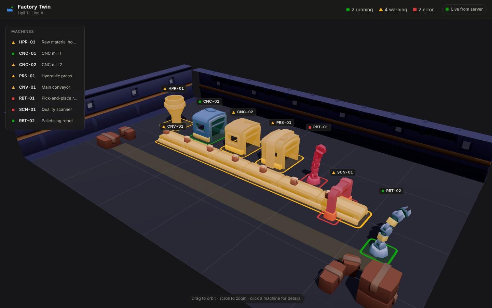
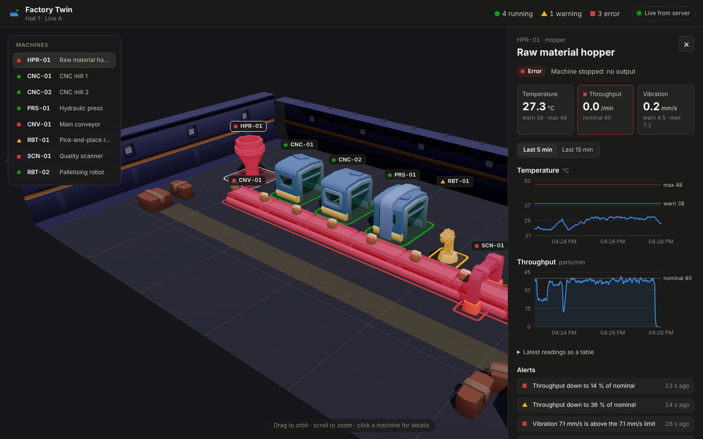
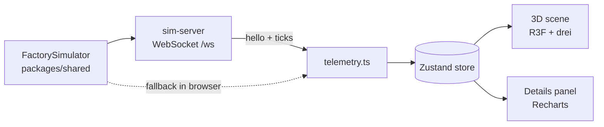

# Factory Twin

[](https://factory-twin-hazel.vercel.app/)
[](https://github.com/michael-panamarou/factory-twin/actions/workflows/ci.yml)

A 3D digital-twin dashboard of a small production hall that runs in the browser.
Simulated live sensor data colours every machine by status (running, warning or error),
and clicking a machine opens a side panel with live charts and alerts.

[](https://factory-twin-hazel.vercel.app/)



## What's in v0.1

- **3D hall** built from free CC0 glTF models (Kenney Factory Kit): a hopper, two CNC mills, a hydraulic press, a conveyor with moving parts, two robot arms and a quality scanner.
- **Orbit camera**: drag to orbit, scroll or pinch to zoom; it stays above the floor.
- **Camera fly-to**: clicking a machine, in 3D or in the machine list, flies the camera to it and keeps it in view beside the details panel (or above it on phones). Escape or a click on empty space flies back to the overview, and dragging to orbit never selects or deselects by accident.
- **Live status colours**: machines in warning turn amber and pulse slowly, machines in error turn red and pulse fast, and running machines keep their own colours with a green floor frame. Each status also has its own shape (● ▲ ■), so it never depends on colour alone.
- **Details panel**: temperature, throughput and vibration with their limits, plus temperature and throughput charts for the last 5 or 15 minutes, a table of the latest readings and the machine's alerts.
- **Animation driven by the data**: robot arms and the conveyor move at a speed set by throughput and stop when a machine faults.
- **Two data sources**: a Node.js WebSocket server, or the same simulator running in the browser. The static demo therefore works without a backend, and the app falls back to the browser simulator when the server can't be reached.
- **Trigger incident button**: starts a fault or a jam on a random running machine and flies the camera to it, so visitors see a machine go amber or red straight away. It works with the server and with the browser simulator.
- **Alert list**: an Alerts button with an unread badge opens every alert in the hall, newest first, filterable by warnings and errors. Choosing one flies the camera to its machine and opens its details. It is a drawer on desktop (the machine is centred between the list and the panel) and full screen on phones.
- A machine list beside the scene for keyboard and screen-reader users, and a bottom-sheet layout on phones.

## Quick start

Requires Node.js 22+.

```bash
npm install
npm run dev          # simulator on :8787 and web app on :5173
```

Open http://localhost:5173. Other options:

| Command | What it does |
|---|---|
| `npm run dev:web` | Web app only; it simulates in the browser if no server is running |
| `npm run dev:server` | Simulator server only (`ws://localhost:8787/ws`) |
| `npm run build` | Production build into `apps/web/dist` |
| `npm test` | Unit and integration tests (Vitest, all workspaces) |
| `npm run test:e2e` | Playwright tests (builds the app and starts both servers) |
| `npm run typecheck` / `npm run lint` | TypeScript and ESLint |
| `npm run dev` | Both at once, on Windows, macOS and Linux 

URL parameters: `?source=local` forces the browser simulator, and `?ws=wss://host/ws` points one session at another server.

## Architecture

```
packages/shared     Types, hall layout, status rules, protocol, deterministic simulator
apps/sim-server     Node.js + ws: runs the simulator, keeps 1 h of history, broadcasts at 1 Hz
apps/web            React + TypeScript + React Three Fiber + drei + Zustand + Recharts
```



**Simulation.** Each machine runs a small state machine (`normal → overheating | bearing wear | jam → fault → recovering`) with seeded noise, so a given seed always produces the same readings. Incidents happen on their own about once every 80 s somewhere in the hall; set `INCIDENT_RATE` to change that.

**Status.** `evaluateStatus()` in `packages/shared/src/status.ts` derives the status from temperature, vibration and throughput against each machine's limits, with hysteresis so a value sitting on a limit doesn't flap between two statuses. The server, the browser fallback and the tests all use this one function.

**Protocol.** On connect the server sends `hello` (machines, the last 15 min of readings, recent alerts), then a `tick` every second with one reading per machine and any new alerts. Every message is validated by `parseServerMessage()` before it reaches the store.
The only message a browser sends is `inject` (from the "Trigger incident" button); the server validates it with `parseClientMessage()` and accepts at most one per client per second.

**Rendering.** Status colours change materials inside `useFrame` (no React re-render). Each model is cloned per machine so its tint is independent; geometry is shared. The whole scene is about 10k triangles and 560 kB of models.

## Configuration

| Where | Variable | Default | Purpose |
|---|---|---|---|
| web | `VITE_WS_URL` | `ws://localhost:8787/ws` in dev, empty in production | Simulator server URL. Empty means simulate in the browser |
| server | `PORT` | `8787` | HTTP and WebSocket port |
| server | `SEED` | current time | Seed for reproducible runs |
| server | `INCIDENT_RATE` | `1` | How often incidents start (0 = never) |
| server | `ALLOWED_ORIGINS` | empty (all allowed) | Comma-separated list of allowed browser origins |
| server | `ALLOW_INJECT` | `true` | Set to `false` to ignore the "Trigger incident" button |

## Deploying the live demo

**Front end (Vercel or Netlify).** Both are already configured (`vercel.json`, `netlify.toml`): import the repository and deploy. With no `VITE_WS_URL` set, the demo runs the simulator in the browser.

**Server (optional).** Any host that runs Docker and supports WebSockets works (Render, Fly.io, Railway):

```bash
docker build -f apps/sim-server/Dockerfile -t factory-twin-sim .
docker run -p 8787:8787 -e ALLOWED_ORIGINS=https://your-demo.vercel.app factory-twin-sim
```

Then set `VITE_WS_URL=wss://your-server/ws` in the front-end project and redeploy.

## CI

`.github/workflows/ci.yml` runs typecheck, lint, unit tests and the build on every push and pull request, then the Playwright suite (desktop and phone) in headless Chromium. The Playwright HTML report is uploaded as an artifact.

To run the end-to-end tests against an existing Chromium instead of the one Playwright downloads, set `PW_CHROMIUM_PATH=/path/to/chrome`.

## Roadmap

- [x] 3D hall from free glTF models
- [x] Orbit camera
- [x] Machines coloured by live data
- [x] Details panel with temperature and throughput charts
- [x] Camera flies to a machine when you click it
- [x] Alert list with "jump to machine"
- [ ] Timeline that replays the last hour (the server already keeps it)
- [ ] Performance: steady 60 fps, lower quality on phones (DPR, shadows, instancing)
- [ ] 2D fallback view

## Credits

- 3D models: [Factory Kit](https://kenney.nl/assets/factory-kit) by Kenney, CC0 (see `apps/web/public/models/LICENSE-Kenney-Factory-Kit.txt`). Status tints are applied at runtime; the files are unmodified.
- Code: MIT, see `LICENSE`.
